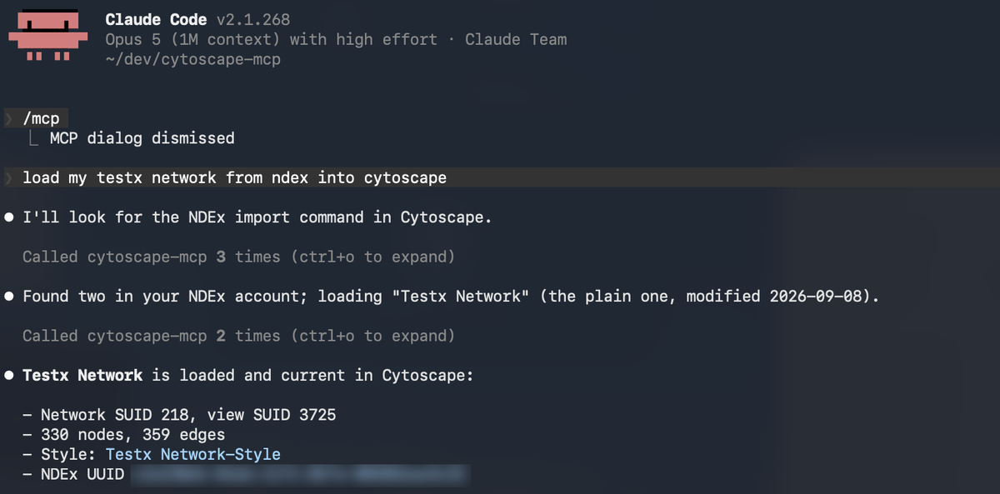

# 智能体集成

Cytoscape 一直以来都可以通过其自身用户界面以外的方式进行操作。Commands 功能、CyREST 接口层，以及 RCy3 和 py4cytoscape 软件包，都允许其他程序打开网络、应用布局、更改样式和导出结果（参见 [Cytoscape 自动化](automation.md)）。

AI 智能体是这一接口的新型客户端。与指定确切命令及其参数的脚本不同，调用方是一个大型语言模型（LLM），它会读取 Cytoscape 功能的描述，推断用户请求所对应的操作，并按顺序执行这些操作。对用户而言，改变的是交互方式，而不是应用程序本身：你描述自己的意图，例如 `load this network and colour the nodes by degree`，智能体就会将其转换为 Cytoscape 已提供的操作。Cytoscape 仍然是绘制、检查和保存结果的地方。

这是一个正在积极发展、变化迅速的领域，本章介绍的各项功能均明确属于实验性功能。不同版本之间的具体细节可能会发生变化。

Cytoscape 已具备智能体接入条件，但默认并未启用智能体功能。本章介绍的所有功能在标准安装中均不可用。该能力由 [Cytoscape App Store](https://apps.cytoscape.org/) 中的一个可选应用提供，需要你自行安装。本章其余部分将介绍该应用，包括如何安装和连接、它提供哪些功能，以及运行后如何与智能体配合使用。

## 安装

Cytoscape MCP Server 并未随 Cytoscape 一起打包，因此在安装它之前，本章内容均不适用。

要求：

- Cytoscape 3.10 或更高版本。
- 支持 MCP 且支持 Streamable HTTP 传输方式的 AI 客户端，例如 Claude Desktop、Claude Code、GitHub Copilot 或 OpenAI Codex CLI。
- 如果需要从 NDEx 加载网络，则需要互联网连接。

该应用有一个运行时属性，可以通过 `Edit -> Preferences -> Properties -> cytoscapemcp` 编辑：

| 属性 | 默认值 | 描述 |
| ---- | ------ | ---- |
| `mcp.ndexbaseurl` | `https://www.ndexbio.org` | 网络加载工具读取网络时所使用的 NDEx 服务器基础 URL。可以将其更改为指向私有或内部 NDEx 实例。更改会立即生效，工具调用时会读取该属性，因此无需重启。 |

### 安装应用

从 Cytoscape App Store 页面安装 [Cytoscape MCP Server](https://apps.cytoscape.org/apps/cytoscapemcpserver)。点击页面上的 Install，Cytoscape 就会加载该应用。如果系统提示重启，请重启 Cytoscape。启动后，当状态栏中出现带有绿色标签的 MCP 按钮时，表示该应用正在运行。

### 查找 MCP URL

智能体所需的一切都可以通过一个 URL 访问：

```
http://localhost:{rest.port}/mcp
```

其中，`{rest.port}` 是 Cytoscape 的 CyREST 端口。如果你没有在 `Edit -> Preferences -> REST API` 中修改端口，其默认值为 `1234`。无需自行拼接 URL，只需点击左下角状态栏中的 MCP 按钮。MCP Server 对话框会显示当前运行实例的实时 URL，以及每种受支持智能体的配置命令。

### 配置智能体

有两种连接方式，二者并不等同。

| 智能体 | 使用方式 |
| ------ | -------- |
| 支持 Streamable HTTP 的客户端：Claude Code、GitHub Copilot、Codex CLI 及大多数其他客户端 | 直接配置上述 MCP URL。无需安装任何内容，也不需要额外进程。 |
| Claude Desktop | 使用 Cytoscape MCP 扩展（`.mcpb`），该扩展包含一个小型的 stdio 到 HTTP 桥接程序。Desktop 扩展使用 stdio 通信，因此需要该桥接程序。 |

两种方式最终都连接到 Cytoscape 内部的同一个 MCP Server。如果你的智能体支持直接填写 URL，就使用该 URL。

#### Claude Desktop

首先进入 `Settings -> Extensions -> Advanced`，启用 `Use Built-in Node.js for MCP`。如果不启用此选项，扩展将无法运行。从项目的 Releases 页面下载 `cytoscape-mcp.mcpb`，然后在 Claude Desktop 中进入 `Settings -> Extensions`，点击 `Install Extension` 并选择下载的文件。

要验证配置，请在 `Customize -> Connectors` 下查找 Cytoscape MCP 连接器。该页面会将 CyREST 端口作为一个设置项显示，默认值为 `1234`。如果你修改了 Cytoscape 中的端口，也应在这里进行相应修改。

#### Claude Code

```
claude mcp add --transport http cytoscape-mcp http://localhost:{rest.port}/mcp
```

使用以下命令验证：

```
claude mcp list
```

#### GitHub Copilot（VS Code）

打开命令面板，运行 `MCP: Add Server`，选择 HTTP，输入 `http://localhost:{rest.port}/mcp`，并将其命名为 `cytoscape-mcp`。

或者在终端中运行：

```
code --add-mcp '
  {
    "name": "cytoscape-mcp",
    "type": "http",
    "url": "http://localhost:{rest.port}/mcp"
  }
'
```

#### GitHub Copilot CLI

```
copilot mcp add --transport http cytoscape-mcp http://localhost:{rest.port}/mcp
```

使用以下命令验证：

```
copilot mcp list
```

#### OpenAI Codex CLI

```
codex mcp add cytoscape-mcp --url http://localhost:{rest.port}/mcp
```

使用 `codex mcp list` 验证，或者在 Codex TUI 中输入 `/mcp`。

### 验证安装

先检查 Cytoscape，再检查智能体。

1. MCP 按钮已出现且呈绿色。在 Cytoscape 窗口左下角查找醒目的 MCP 按钮。绿色表示服务器已启动并准备就绪。红色表示服务器没有响应。请确认 Cytoscape 正在运行，并且 CyREST 已启用。
2. MCP Server 对话框能够打开。点击该按钮，应当会打开标题为 MCP Server 的对话框。对话框顶部应显示一条绿色提示，内容为 `MCP server running at`，后面跟着当前运行实例的端点 URL，并列出各受支持智能体的连接说明。
3. 健康检查端点能够响应。
   ```
   curl http://localhost:{rest.port}/mcp/health
   ```
   你应该看到：
   ```json
   { "status": "ok", "transport": "mcp-streamable-http" }
   ```
   如果出现 `connection refused` 错误，说明 Cytoscape 未运行，或者使用的端口不正确。
4. 智能体报告已连接。大多数智能体都有 `/mcp` 命令或 MCP 设置面板，其中会列出已配置的服务器、连接状态以及它们提供的工具。`cytoscape-mcp` 应当显示为已连接。
5. 提示词能够传达到 Desktop。向智能体发送以下请求：`open a network using cytoscape desktop`。该网络应出现在 Cytoscape 的 Network 面板中，并在主画布中呈现；工具调用记录则应出现在 `View -> Show Task History` 中。

!!! warning "警告"

    Cytoscape 是一个具有共享会话状态的单用户应用程序。该传输方式支持多个智能体同时连接，每个智能体都有自己的会话，但它们可能执行相互冲突的命令，例如两个智能体同时更改当前视图。不建议多个智能体同时操作同一个 Cytoscape 实例，协调这些智能体的责任由你承担。

## MCP

模型上下文协议（Model Context Protocol，MCP）是一种开放标准，用于描述 AI 应用程序如何与外部系统通信。外部系统运行一个 MCP 服务器，该服务器会发布一组工具。这些工具是具有名称、类型化输入和输出的操作，并且每个工具都附带一段供语言模型阅读的描述。智能体会发现这些工具，判断用户请求需要调用哪些工具，然后执行相应操作。由于该协议是通用的，任何支持 MCP 的智能体都可以与任何 MCP 服务器通信。

由于 Cytoscape MCP Server 并非核心应用，因此它采用独立的版本管理，不会随着 Cytoscape 一起更新。当智能体看到的工具与本章描述不一致时，需要记住这一点。

!!! note "注意"

    该应用属于实验性应用。它发布的工具及其行为可能会发生变化。

安装后，该应用会在 Cytoscape 现有的 CyREST HTTP 服务器中发布一个 MCP 端点。它不会启动独立进程，也不会打开额外端口。该端点位于 CyREST 现有端口的 `/mcp` 路径下。智能体通过 Streamable HTTP 传输方式与其连接。（旧版 SSE 传输方式已于 2025 年 2 月弃用，不受支持。）

该应用还会在 Cytoscape Desktop 界面中添加两个指示项：

- MCP 状态按钮。左下角状态栏中会出现一个醒目的 MCP 按钮。MCP 服务器正在运行并准备接受连接时，标签为绿色；服务器没有响应时，标签为红色。点击该按钮会打开 `MCP Server` 对话框，其中显示实时端点 URL，以及各受支持智能体的连接说明。
- 任务历史记录。每次 MCP 工具调用都会记录在 `Cytoscape Task History` 窗口中。该窗口可通过 `View -> Show Task History` 打开。每条记录都是工具运行时报告的进度或状态信息，并使用工具的内部类名标识工具，而不是智能体所使用的名称。这些记录能够反映智能体实际对当前会话执行的操作；当结果与预期不符时，应首先查看这里。

上面的记录来自一个被要求搜索 NDEx 的智能体：网关调用了 CyNDEx-2 的 `ndex search networks` 命令，该命令报告了执行进度，随后报告了找到的匹配项数量。

### 工具覆盖范围

已发布的工具涵盖了大部分原本需要手动完成的操作：

- 将网络加载为新的网络集合并创建视图。可以通过 NDEx 网络 ID、网络文件（SIF、GML、XGMML、CX、CX2、GraphML、SBML、BioPAX），或者带有列映射的分隔符文件或 Excel 文件进行加载。
- 列出已加载的网络视图、切换当前视图，以及为尚无视图的网络创建视图。
- 分析网络、列出可用的布局算法，并应用布局算法。
- 读取和设置视觉样式默认值、列出样式，以及在不同样式之间切换。
- 创建离散映射、连续映射和直通映射，包括先检查列的取值范围或不同值，以便选择合理的映射点。
- 检查表格文件中的列，并将其导入节点表、边表或未分配表。

除此之外，还有三个命令网关工具，可以让智能体访问你计算机上注册的全部 Cytoscape 命令目录：一个工具通过全文查询搜索命令目录，一个工具获取命令的完整参数模式，另一个工具执行命令。这三个工具按照特定顺序使用：网关会拒绝执行尚未获取参数模式的命令，从而阻止智能体猜测参数名称。

这一点比听起来更重要。安装另一个 Cytoscape 应用时，该应用的命令会注册到 Desktop 中，网关会自动获取这些命令。因此，随着你安装的应用增加，智能体能够执行的操作也会随之扩展，而无需修改 MCP 应用本身。[智能体使用](#智能体使用)一节中的操作示例展示了这一过程：智能体通过网关发现的命令访问 NDEx，而不是使用内置的 NDEx 工具。

### 工具目录

你无需通过名称调用工具。所有工具都通过自然语言激活：你描述自己的需求，模型便会根据提供给它的工具描述选择工具。服务器上注册的所有工具都有一份完整、易于阅读的目录可供参考，其中列出了每个工具完整的 JSON 输入和输出模式，以及三到四个示例提示词，展示哪些措辞可以触发相应操作。当请求没有产生预期操作时，可以查阅该目录。示例措辞是找到有效表达方式最快的途径。

可以通过以下三种方式获取工具目录：

- Cytoscape 正在运行时，直接从服务器获取：
  ```
  curl http://localhost:{rest.port}/mcp/manifest
  ```
  也可以在浏览器中打开该 URL。
- 从应用的代码仓库获取：[MCPManifest.md](https://github.com/cytoscape/cytoscape-desktop-mcp/blob/main/MCPManifest.md)。
- 在智能体中使用 `/mcp` 命令或 MCP 设置面板获取，其中会列出每个已连接服务器当前发布的工具。

### 进一步阅读

该应用维护了自己的文档，包括用户手册、教程、智能体配置详情和常见问题解答。这些文档比本章内容更加详细，并且会随着每次发布进行更新：<https://github.com/cytoscape/cytoscape-desktop-mcp>。

### 智能体使用

#### 提示词的工作方式

你不需要指定工具名称，只需描述自己的需求，模型就会进行选择。

关键在于在提示词中明确提及 Cytoscape，并具体说明你的意图。例如，`open a network using cytoscape desktop` 这样的提示词，就足以让模型分析整个工具集并组织一系列操作：它会询问你所指的数据源，从该数据源加载网络，创建视图，并将该视图设置为当前视图。一个句子就能触发多次工具调用，这些调用会依次显示在任务历史记录中。

以下是 Claude Code 连接 Cytoscape 后的实际示例：



一句话 `load my testx network from ndex into cytoscape` 触发了两轮工具调用。智能体首先搜索命令目录，查找 NDEx 导入命令。随后使用已登录的用户配置文件，按名称查找网络，找到两个候选项，根据它们的修改日期进行选择，然后加载了最终结果。随后，智能体报告了 Cytoscape 中实际存在的内容：网络和视图标识符、节点数和边数、应用的样式，以及现已记录在该网络上的 NDEx UUID。

这次交互有两点值得注意。第一，`my` 一词发挥了实际作用，它通过 Cytoscape 中配置的 CyNDEx-2 登录配置文件进行解析，下一节的 [NDEx 部分](#使用-ndex)将对此进行介绍。第二，智能体并没有专门用于 `load from NDEx` 的工具，而是通过网关发现了 CyNDEx-2 的命令，这正是本章前面介绍的机制。

模糊或缺乏限定条件的请求通常是操作没有发生的原因。`Change the colours` 没有提供足够的信息供模型匹配。`change the network node color to green in cytoscape` 则更加明确。当请求没有产生预期操作时，请查阅[工具目录](#工具目录)，每个工具都包含已知能够触发该工具的示例提示词。

#### 示例提示词

这些示例来自该应用在 App Store 中的介绍，可以作为合理的起始表达方式。

| 提示词 | Cytoscape 中发生的操作 |
| ------ | ---------------------- |
| open a network using cytoscape desktop | 智能体会询问你要使用哪个数据源：NDEx、网络文件或表格文件，然后将其加载为新的网络集合，并将其视图设为当前视图。 |
| analyze the network in cytoscape | 对当前网络运行网络分析，并报告分析所得的统计数据。 |
| change the network layout | 列出可用的布局算法，然后将你选择的算法应用于当前视图。 |
| switch network style | 列出当前会话中的样式，并将当前视图切换为你选择的样式。 |
| increase the network edge width by 1 | 读取当前的边宽度默认值，并设置新的宽度。 |
| change the network node color to green | 设置当前样式中的节点填充颜色默认值。 |
| change node label to courier new | 设置节点标签的默认字体。 |
| lock node width and height on network | 启用节点宽度与高度之间的依赖关系，使二者保持相等。 |
| import new attributes into the node table of my network in cytoscape | 检查文件中的列，确认用于匹配的键列和网络列，然后导入该表格。 |
| map edge shape to interaction | 根据 `interaction` 列创建到边形状的离散映射。 |
| map weight to node size | 创建到节点大小的映射，并锁定宽度和高度，使二者保持一致。 |
| generate green colors on edges based on discrete values of confidence | 读取 `confidence` 的不同值，并据此生成离散颜色映射。 |
| set color gradient on nodes from blue to red based on eccentricity | 读取 `eccentricity` 的取值范围，并据此创建连续颜色映射。 |
| set node label to gene1 | 根据 `gene1` 列创建直通映射，将该列的值用作节点标签。 |

#### 使用 NDEx

[NDEx](https://www.ndexbio.org)（网络数据交换平台，Network Data Exchange）是许多 Cytoscape 用户存储网络的地方，智能体可以直接与其交互。智能体能够访问哪些网络，由你在 Cytoscape 中设置的 NDEx 登录配置文件决定，而不是由智能体决定，这使得 `my networks` 这样的表述能够对应到具体的网络。如果没有配置登录配置文件，智能体仍然可以搜索和下载公开网络，但无法将网络保存到你的账户中。有关相同功能的交互式操作方式，请参阅[导出数据](export-your-data.md#network-data-exchange-ndex-公共数据库)。

以下每个提示词都会通过右侧列出的命令操作 NDEx。

| 提示词 | Cytoscape 中发生的操作 |
| ------ | ---------------------- |
| load my ndex network xyz into cytoscape | 使用你选择的配置文件，针对该网络的 UUID 运行 `ndex download network`，并将其作为新的网络和视图打开。 |
|find ndex networks that start with ergosterol | 运行 `ndex search networks searchTerm=ergosterol`，并报告匹配项及其 UUID、所有者和大小。注意：NDEx 会在网络名称、描述或所有者的任何位置匹配该词，而不仅仅是在开头。因此，即使请求使用 `starting with` 的表述，也会返回所有提及该词的网络。 |
| upload my xyz network to ndex | 运行 `ndex create network`，将当前网络作为一个新网络保存到 NDEx，并返回其 UUID 和 URL。 |

#### 提示与故障排除

- 在提示词中明确提及 Cytoscape。`apply a force-directed layout in cytoscape` 是明确的请求，`apply a force-directed layout` 则可能不够明确。
- 如果当前会话中有多个网络，请说明你指的是哪个网络。大多数工具都会作用于当前视图。
- 查看任务历史记录。`View -> Show Task History` 会记录实际执行的操作，这是判断请求被误解还是操作执行失败的最快方式。
- 缺少某项功能可能只是因为缺少相应的应用。命令网关只能看到已注册到 Desktop 的命令。如果智能体找不到执行某项操作的方法，安装相关的 Cytoscape 应用即可注册其命令，网关随后会自动获取这些命令，无需修改 MCP 应用。
- 如果智能体报告服务器不可用，请先检查 MCP 按钮的颜色和 `/mcp/health` 端点，再修改任何智能体配置。红色按钮表示问题出在 Cytoscape，而不是智能体。
- 如需进行更深入的诊断，服务器提供完整的工具目录，地址为 `/mcp/manifest`。此外，该应用还提供了[诊断步骤](https://github.com/cytoscape/cytoscape-desktop-mcp?tab=readme-ov-file#cytoscape-desktop-mcp-diagnostics)和[常见问题解答](https://github.com/cytoscape/cytoscape-desktop-mcp/blob/main/docs/FAQ.md)。
