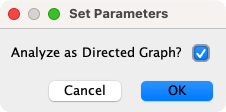
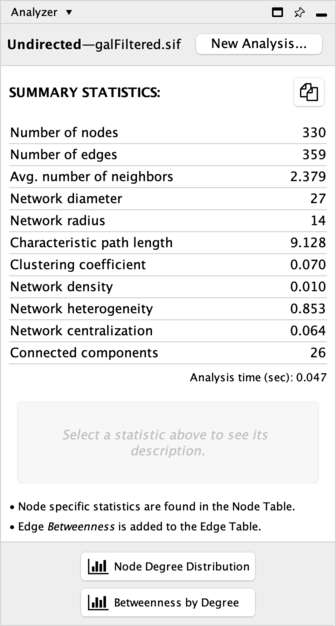

# 网络分析器

分析器可以为有向和无向网络计算一系列拓扑度量，包括：

- 节点、边和连接组件的数量。
- 网络直径、半径和聚类系数，以及特征路径长度。
- 拓扑系数、介数中心度和接近度中心度。
- 度分布、邻域连接度、平均聚类系数、最短路径长度、共享邻居数和重力中心度。

## 网络分析

### 分析网络

通过 `Tools -> Analyze Network` 运行分析。

根据网络是有向还是无向的，分析器会计算不同的统计信息。应用会根据目标箭头样式的定义来猜测网络的类型。

结果计算完毕后，将出现在结果面板中。

结果面板的标题区域会显示所采用的网络解释方式（有向或无向）以及被分析网络的名称。`New Analysis...` 按钮可以重新运行分析，例如采用另一种网络解释方式。

Summary Statistics 表格列出了下文介绍的网络级指标。将鼠标悬停在某一行上，可以查看该指标的简短说明；选中某一行，可以在表格下方查看更详细的说明，包括相应的计算公式（如果有）。表格标题旁的复制按钮可以将所有统计结果复制到剪贴板。针对节点的统计指标会添加到 `Node Table` 中，边的介数中心性会添加到边表 `Edge Table` 中。

面板底部提供了用于绘制节点度分布和按度划分的介数中心性的图表按钮。在有向网络分析中，可以通过单选按钮选择绘制入度（Indegree）或出度（Outdegree）的分布。

### 汇总统计

以下指标按照它们在汇总统计表中的排列顺序列出。除非另有说明，所有指标均针对有向和无向两种网络解释方式计算。

#### 节点数（Number of nodes）

网络中的节点总数，包括没有任何连接的节点。

#### 边数（Number of edges）

按照分析所采用的网络解释方式计算的网络边总数（根据所选择的网络解释方式，成对的边可能会被合并）。

#### 平均邻居数（Avg. number of neighbors）

所有节点的邻居数量的平均值，用于表示网络中一个节点的平均连接程度。对于简单无向网络，网络密度等于该值除以 $N-1$，其中 $N$ 是节点数。在有向网络分析中，无论边的方向如何，都会计算邻居。

#### 网络直径（Network diameter）

两个节点之间的距离是连接这两个节点的最短路径所包含的边数。网络直径是任意两个节点之间距离的最大值；不存在连接路径的节点对不纳入计算。在有向网络分析中，路径遵循边的方向。

#### 网络半径（Network radius）

节点的离心率是指从该节点到其所在连通分量中的任意其他节点的最短路径距离的最大值。网络半径是节点离心率的最小非零值（网络直径则是最大值）。在有向网络分析中，节点的离心率是从该节点出发，沿着边的方向到达所有可达节点的最短路径距离的最大值。

#### 特征路径长度（Characteristic path length）

也称为平均最短路径长度，是所有存在路径的节点对之间最短路径距离的平均值。它表示随机选择两个相互连通的节点时，预期的距离。在有向网络分析中，路径遵循边的方向，并且节点对是有序的：从一个节点到另一个节点的距离可能与反方向的距离不同。

#### 聚类系数（Clustering coefficient）

节点 $n$ 的聚类系数用于衡量其邻居之间的连接程度：

$$
C_n = \dfrac{2e_n}{k_n \left(k_n - 1\right)}
$$

其中，$k_n$ 是节点 $n$ 的邻居数量，$e_n$ 是这些邻居之间的边数。网络聚类系数是所有节点 $C_n$ 的平均值，邻居少于两个的节点按 0 计算。其取值范围为 0 到 1：0 表示任何节点的邻居之间都不存在连接；1 表示每个节点的邻居之间都完全连接。

在有向网络分析中：

$$
C_n = \dfrac{e_n}{k_n \left(k_n - 1\right)}
$$

其中，$k_n$ 是节点 $n$ 的邻居数量，不考虑边的方向；$e_n$ 是这些邻居之间的有向边数，每条边单独计数。

#### 网络密度（Network density）

网络密度是实际存在的边占所有可能边的比例。对于具有 $N$ 个节点和 $E$ 条边的网络：

$$
D = \dfrac{2E}{N \left(N - 1\right)}
$$

其取值范围为 0 到 1：0 表示不存在边；1 表示所有可能的边都存在。不考虑自环和重复边。

在有向网络分析中：

$$
D = \dfrac{E}{N \left(N - 1\right)}
$$

因为每对节点之间都可能在两个方向上分别存在一条边。

#### 网络异质性（Network heterogeneity）

仅适用于无向网络分析。

网络异质性是节点度的变异系数，即节点度的标准差除以其平均值。数值越高，表示节点之间的连接程度差异越大，部分节点充当枢纽节点的倾向越明显。

#### 网络中心化程度（Network centralization）

仅适用于无向网络分析。

网络中心化程度用于衡量节点度集中在少数节点上的程度：

$$
C = \dfrac{N}{N-2} \left(\dfrac{k_{\max}}{N - 1} - D\right)
$$

其中，$k_{\max}$ 是最大的节点度，$D$ 是网络密度。星形网络的中心化程度接近 1，而所有节点拥有相同数量邻居的网络，其中心化程度接近 0。

#### 连通分量（Connected components）

连通分量是一个极大节点集合，其中任意两个节点之间都存在一条位于该分量内部的路径。连通分量的数量表示网络的碎片化程度：完全连通的网络只有一个连通分量。计算连通分量时始终忽略边的方向；对于有向网络，从图论术语来说，这些分量称为弱连通分量。

#### 多重边节点对（Multi-edge node pairs）

通过多条边连接的无序节点对的数量，这些边可以是重复边或平行边。计算时忽略边的方向，因此，同一对节点之间即使存在两条方向相反的边，也会形成一个多重边节点对。

#### 自环数量（Number of self-loops）

起点和终点为同一个节点的边的数量。

### 分析节点子集

此工具的早期版本提供了分析所有节点或所选子集的选项，目前不再支持此功能。如果要分析子网络，需要使用 `File -> New Network -> From Selected Nodes, All Edges` 来预先创建所需的子网络。

### 绘图度量

运行分析器后，会在 `Node Table` 中添加额外的列（并在 `Edge Table` 中添加一个 `EdgeBetweenness` 列）。要绘制这些新列中的任何一个，右键单击列标题，选择 `Plot Histogram...` 绘制单个参数分布，选择 `Plot Scatter...` 绘制双变量数据图。在这两个图表的任意一个中都可以选择一部分数据，网络视图窗口中则会选择对应的节点（边）。

有关其他信息，请参阅 Yassen Assenov，Nadezhda Doncheva，Thomas Lengauer 和 Mario Albrecht，DOI: [10.1038/nprot.2012.004](https://doi.org/10.1038/nprot.2012.004)。
